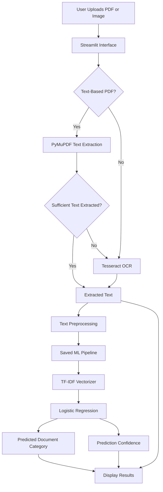
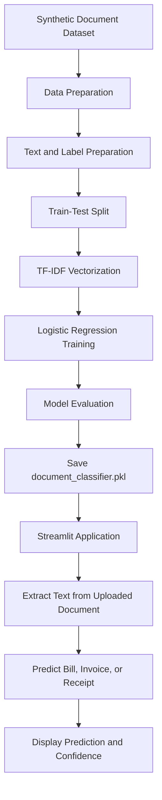

# 📄 DocuSense — AI-Powered PDF Document Classifier

<p align="center">
  <b>An OCR-Powered Machine Learning Application for PDF Document Classification</b>
</p>

<p align="center">
  
  
  
  
  
</p>

---

## 🚀 Project Overview

## 🌐 Live Demo

🚀 **Try the application:** [DocuSense — PDF Document Classifier](https://docusense-ai-classifier.streamlit.app/)

💻 **Source Code:** [View on GitHub](https://github.com/tanush090/DocuSense-AI-Classifier)

Upload a PDF or supported image to extract its text and predict whether the document is a **Bill, Invoice, or Receipt**.

**DocuSense** is an AI-powered document classification application that combines Optical Character Recognition (OCR), PDF text extraction, and machine learning to automate document categorization.

The application uses **PyMuPDF** to extract text from digital PDFs and **Tesseract OCR** to recognize text from scanned documents when necessary. The extracted text is processed using **TF-IDF Vectorization** and classified using a trained **Logistic Regression** model.

The application is built with Streamlit and displays the predicted document category, prediction confidence, and extracted text.

## ✨ Features

- 📄 Upload PDF documents and supported images for classification.
- 🔍 Extract text from digital PDFs using PyMuPDF.
- 🖼️ Recognize text from scanned documents using Tesseract OCR.
- 🧠 Convert extracted text into numerical features using TF-IDF.
- 🤖 Classify documents into Bill, Invoice, and Receipt categories.
- 📊 Display prediction confidence scores.
- 📝 Preview and download extracted text.
- 📦 Use a saved machine learning model without retraining during normal predictions.
- 🌐 Interactive Streamlit web interface.
- 🔄 Separate scripts for model training, evaluation, and prediction.

## 🏗️ System Architecture



## 🔄 Machine Learning Workflow



## 🧠 Model Details

| Component | Description |
|---|---|
| Problem Type | Multiclass text classification |
| Input | Extracted text from PDFs and supported images |
| Output Classes | Bill, Invoice, Receipt |
| PDF Processing | PyMuPDF |
| OCR Engine | Tesseract OCR |
| Feature Extraction | TF-IDF Vectorizer |
| Classification Algorithm | Logistic Regression |
| Machine Learning Library | Scikit-learn |
| Model Serialization | Joblib |
| Saved Model | `document_classifier.pkl` |
| Web Framework | Streamlit |

The classification model learns patterns in document text using TF-IDF features and Logistic Regression. OCR and PDF extraction provide the text that the model uses for classification.

## 📊 Dataset

This project uses a synthetic dataset named:

`synthetic_indian_bill_invoice_receipt_3000.csv`

The dataset contains **3,000 records**, with 1,000 records per category:

- Bill
- Invoice
- Receipt

### Dataset Preparation

- Prepared synthetic document text samples for the three categories.
- Organized records using their corresponding document labels.
- Converted text into numerical features using TF-IDF.
- Trained a Logistic Regression classifier.
- Evaluated the model using held-out synthetic data.

**Note:** The dataset is synthetic and does not fully represent the variety of real-world documents. Performance on actual bills, invoices, and receipts may differ.

## 💡 Example Predictions

| Document Text | Expected Category |
|---|---|
| Electricity consumption charges and payment due date | `Bill` |
| Invoice number, vendor details, and amount payable | `Invoice` |
| Payment received, transaction details, and total paid | `Receipt` |

*These examples are illustrative. Actual predictions depend on the extracted text and the trained model.*

## 🛠️ Tech Stack

- **Language:** Python
- **Data Processing:** Pandas
- **Machine Learning:** Scikit-learn
- **Text Feature Extraction:** TF-IDF Vectorization
- **Classification Algorithm:** Logistic Regression
- **PDF Processing:** PyMuPDF
- **Optical Character Recognition:** Tesseract OCR
- **OCR Integration:** Pytesseract
- **Model Serialization:** Joblib
- **Image Processing:** Pillow
- **Web Application:** Streamlit
- **Dataset:** Synthetic Indian Bill, Invoice, and Receipt Records

## 📁 Project Structure

```text
DocuSense/
│
├── app.py
├── document_classifier.pkl
├── synthetic_indian_bill_invoice_receipt_3000.csv
├── requirements.txt
├── packages.txt
├── README.md
├── .gitignore
│
└── src/
    ├── train.py
    ├── evaluate.py
    └── predict.py
```

**File descriptions:**

- `app.py` — Streamlit application for uploading, processing, and classifying documents.
- `document_classifier.pkl` — Saved machine learning model or pipeline.
- `synthetic_indian_bill_invoice_receipt_3000.csv` — Synthetic dataset used for model development.
- `requirements.txt` — Python dependencies.
- `packages.txt` — System packages required for deployment, including Tesseract OCR.
- `src/train.py` — Model training script.
- `src/evaluate.py` — Model evaluation script.
- `src/predict.py` — Prediction utility.

*Adjust the structure to match the files actually present in your GitHub repository.*

## ⚙️ Installation and Usage

### 1. Clone the repository

```bash
git clone https://github.com/tanush090/DocuSense-AI-Classifier.git
cd DocuSense-AI-Classifier
```

### 2. Install Python dependencies

```bash
python -m pip install -r requirements.txt
```

### 3. Install Tesseract OCR

For macOS with Homebrew:

```bash
brew install tesseract
```

For Ubuntu or Debian:

```bash
sudo apt update
sudo apt install tesseract-ocr
```

On Windows, install the Tesseract OCR engine and ensure its executable is available to Pytesseract.

### 4. Run the Streamlit application

Ensure `document_classifier.pkl` is present at the location expected by `app.py`.

```bash
streamlit run app.py
```

Open the local URL displayed in your terminal to interact with the application.

## 🔁 Train the Model

To retrain the classifier, ensure the synthetic dataset is available and the training script uses the correct dataset path.

Run the following command from the repository root:

```bash
python src/train.py
```

The training script should prepare the text data, train the TF-IDF and Logistic Regression pipeline, evaluate the results, and save the trained model.

*The exact output path depends on the implementation of `src/train.py`.*

## 📈 Evaluate the Model

To evaluate the trained classifier, run:

```bash
python src/evaluate.py
```

The evaluation script can report classification metrics such as:

- Accuracy
- Precision
- Recall
- F1-score
- Confusion matrix

These metrics help assess how well the classifier distinguishes the three document categories.

### Reported Results

The model achieved **100% accuracy on a held-out set of 600 synthetic records** during the reported evaluation.

This result applies to the synthetic test set only. It should not be interpreted as guaranteed accuracy on real-world documents. Evaluation on independent, real-world documents is necessary to measure practical performance.

## 🔍 Predict a Document Category

If `src/predict.py` supports interactive predictions, run:

```bash
python src/predict.py
```

Provide the text input requested by the script to obtain a predicted document category.

For PDF and image uploads, use the Streamlit application to run the complete extraction and classification workflow.

## 🌐 Deployment

The application can be deployed using **Streamlit Community Cloud**.

1. Push the required project files to GitHub.
2. Open [Streamlit Community Cloud](https://share.streamlit.io/).
3. Sign in using your GitHub account.
4. Create a new application.
5. Select the repository and deployment branch.
6. Set the main file path to `app.py`.
7. Configure the required Python dependencies in `requirements.txt`.
8. Configure `packages.txt` to install the Tesseract OCR system package.
9. Deploy the application.

The deployment requires the application code, saved model, Python dependencies, and OCR system dependency. The synthetic training dataset is only required at runtime if the application or its supporting scripts explicitly load it.

## 🎯 Project Objective

The objective of DocuSense is to demonstrate how PDF processing, OCR, Natural Language Processing techniques, and machine learning can work together to automate document classification.

The project explores a practical document-processing workflow that can help organize digital records and reduce manual categorization.

## 🔮 Future Improvements

- Expand the dataset with diverse real-world documents.
- Improve OCR performance on low-resolution and rotated scans.
- Add batch document processing.
- Extract structured information such as invoice numbers, dates, vendors, and totals.
- Support additional document categories.
- Evaluate more advanced text and document classification models.
- Add automated testing and real-world performance evaluation.

## 👨‍💻 Author

**Tanush Kumar**

B.Tech CSE — Artificial Intelligence & Machine Learning  
Expected Graduation: 2028

- GitHub: [tanush090](https://github.com/tanush090)
- LinkedIn: [tanush0900](https://www.linkedin.com/in/tanush0900/)
- Portfolio: [tanush-portfolio-26.vercel.app](https://tanush-portfolio-26.vercel.app)

---

<p align="center">
  ⭐ If you find this project interesting, consider starring the repository!
</p>
