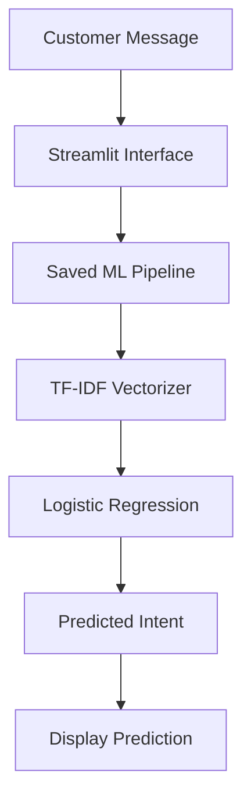
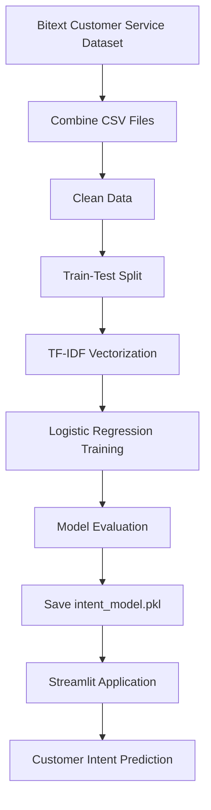

# 💬 Customer Support Intent Predictor

<p align="center">
  <b>An NLP-powered Machine Learning Application for Customer Intent Classification</b>
</p>

<p align="center">
  
  
  
  
</p>

---

## 🚀 Project Overview

The **Customer Support Intent Predictor** is a machine learning application that identifies the intent behind a customer's message using Natural Language Processing (NLP).

The project uses **TF-IDF Vectorization** to transform text into numerical features and **Logistic Regression** to classify customer support messages into intent categories.

Users can enter a statement in the Streamlit interface and receive a predicted intent using the saved machine learning pipeline.

## ✨ Features

- 💬 Predict customer intent from natural-language messages.
- 🧠 TF-IDF text feature extraction.
- 🤖 Logistic Regression classification.
- 📦 Saved model pipeline for predictions without retraining.
- 📊 Model evaluation using accuracy, precision, recall, F1-score, and a confusion matrix.
- 🌐 Interactive Streamlit web interface.
- 🔄 Separate scripts for training, evaluation, and prediction.

## 🏗️ System Architecture



## 🔄 Machine Learning Workflow



## 🧠 Model Details

| Component | Description |
|---|---|
| Problem Type | Multiclass text classification |
| Input | Customer support message |
| Feature Extraction | TF-IDF Vectorizer |
| Classification Algorithm | Logistic Regression |
| Machine Learning Library | Scikit-learn |
| Model File | `intent_model.pkl` |
| Web Framework | Streamlit |

The saved pipeline includes both the TF-IDF vectorizer and Logistic Regression classifier, allowing new messages to be processed using the same learned text representation.

## 📊 Dataset

This project uses the **Bitext Sample Customer Service Dataset** from Kaggle.

🔗 **Dataset Link:** [Training Dataset for Chatbots and Virtual Assistants](https://www.kaggle.com/datasets/bitext/training-dataset-for-chatbotsvirtual-assistants)

The dataset contains customer-service utterances associated with intent labels.

### Dataset Preparation

- Combined the training, testing, and validation CSV files.
- Checked missing values and duplicate rows.
- Removed rows without an utterance or intent label.
- Removed duplicate rows.
- Created a stratified training and testing split.

**Note:** The training script expects the CSV files in `data/archive/`. Download the dataset from Kaggle and arrange the files accordingly before retraining. The deployed application uses the saved model and does not require the original CSV files.

## 💡 Example Predictions

| Customer Message | Example Intent |
|---|---|
| I want to cancel my order | `cancel_order` |
| Where is my package? | `track_order` |
| I forgot my password | `reset_password` |
| I was charged twice | `payment_issue` |
| I want to speak to a human agent | `contact_human_agent` |

*Examples are illustrative. Actual predictions depend on the trained model and its available intent classes.*

## 🛠️ Tech Stack

- **Language:** Python
- **Data Processing:** Pandas
- **Machine Learning:** Scikit-learn
- **NLP:** TF-IDF Vectorization
- **Algorithm:** Logistic Regression
- **Model Serialization:** Joblib
- **Web Application:** Streamlit
- **Dataset Source:** Kaggle

## 📁 Project Structure

```text
customer-intent-predictor/
│
├── app.py
├── intent_model.pkl
├── requirements.txt
├── README.md
│
└── src/
    ├── train.py
    ├── evaluate.py
    └── predict.py
```

## ⚙️ Installation and Usage

### 1. Clone the repository

```bash
git clone https://github.com/tanush090/customer-intent-predictor.git
cd customer-intent-predictor
```

### 2. Install dependencies

```bash
python -m pip install -r requirements.txt
```

### 3. Run the Streamlit application

```bash
streamlit run app.py
```

Open the local URL displayed in your terminal to interact with the application.

## 🔁 Train the Model

To retrain the model, download the dataset from Kaggle and place the three CSV files in `data/archive/` using the filenames expected by `src/train.py`.

Run the following command from the repository root:

```bash
python src/train.py
```

The script trains the pipeline, prints evaluation metrics, and saves `intent_model.pkl` in the current working directory.

## 📈 Evaluate the Model

After training and preparing the dataset, run:

```bash
python src/evaluate.py
```

This script reports accuracy, precision, recall, F1-score, and the confusion matrix.

## 🔍 Predict a Customer Intent

Run the prediction script:

```bash
python src/predict.py
```

Enter a customer statement when prompted to see the predicted intent.

## 🌐 Deployment

The application can be deployed using **Streamlit Community Cloud**.

1. Push the required application files to GitHub.
2. Open [Streamlit Community Cloud](https://share.streamlit.io/).
3. Sign in with GitHub and create a new app.
4. Select this repository and the `main` branch.
5. Set the main file path to `app.py`.
6. Click **Deploy** and wait for the application to start.

The deployed application requires `app.py`, `intent_model.pkl`, and `requirements.txt` in the repository root.

## 🎯 Project Objective

The objective of this project is to demonstrate how NLP and machine learning can classify customer support requests and help automate the initial stages of customer-service workflows.

## 👨‍💻 Author

**Tanush Kumar**

B.Tech CSE — Artificial Intelligence & Machine Learning  
Expected Graduation: 2028

- GitHub: [tanush090](https://github.com/tanush090)
- LinkedIn: [tanush0900](https://www.linkedin.com/in/tanush0900/)
- Portfolio: [tanush-portfolio-26.vercel.app](https://tanush-portfolio-26.vercel.app)

---

<p align="center">
  ⭐ If you find this project interesting, consider starring the repository!
</p>
